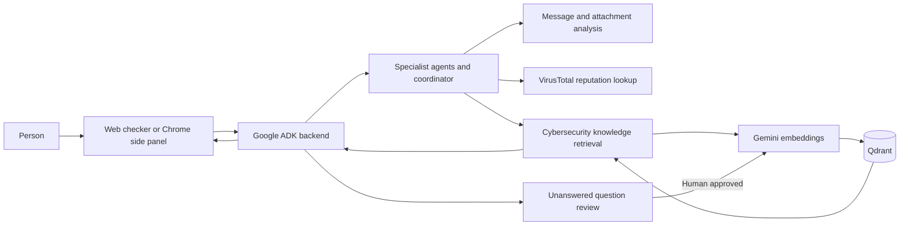

# Project Alesia

### A cybersecurity companion for the moments something feels off.

**Built by Team Kuih-Lapis**

Scams often arrive as an ordinary text, a convincing link, a screenshot, or a download that cannot wait. Project Alesia gives people a place to pause: share what looks suspicious, get a clear risk assessment with supporting evidence, and see a practical next step.

Alesia brings together a browser extension, a web checker, and a multi-agent AI backend. Specialist agents analyze user-provided messages and attachments, check requested URLs against VirusTotal reputation data, and retrieve cybersecurity guidance from a human-reviewed knowledge base. When the knowledge base cannot answer, the question can be reviewed by an engineer and added to the knowledge base after approval.

> AI assessments are guidance, not proof. Verify important claims through an official channel you find independently.

## What Alesia does

- **Checks suspicious messages and screenshots.** Analyze text, images, and supported documents for scam indicators, with evidence-based risk guidance.
- **Checks links and download sources.** Look up URL, domain, or IP reputation through VirusTotal. The browser extension can pause a download while it checks the source domain.
- **Answers cybersecurity questions with retrieved evidence.** The knowledge assistant searches a Qdrant collection and grounds answers in its retrieved records.
- **Improves through human review.** Unanswered questions can be sent to a review sheet. Only approved entries are embedded and added to the knowledge base.
- **Sanitizes the review queue.** Common email addresses, phone numbers, national ID patterns, credentials, private URL parameters, and abusive language are redacted before unanswered content is written to Google Sheets or the local review log. This is a defense-in-depth filter, not a complete PII detector.
- **Keeps safety guidance close.** The extension includes optional awareness reminders and clear actions when a download reputation check needs attention.

## How it works



## Technology stack

| Area | Technology |
| --- | --- |
| Backend and agent orchestration | Python 3.13, Google ADK |
| Chat and analysis model | Google Gemini 3.5 Flash by default; Ollama and OpenRouter are also supported |
| Embeddings | Google Gemini `gemini-embedding-001`, 768 dimensions by default |
| Vector database | Qdrant, local or Qdrant Cloud |
| Web checker | Next.js, React, TypeScript |
| Browser extension | WXT, React, TypeScript |
| Threat intelligence | VirusTotal MCP read-only lookups |
| Human review | Google Sheets API |
| Optional publishing | Confluence REST API |
| Attachment processing | PDF text extraction and local Tesseract OCR |

## Get started

### Before running setup

Open the repository folder in VS Code, then open its PowerShell terminal. Install these prerequisites first; `setup.ps1` installs this project's dependencies but does not install system software or create external accounts:

- **Python 3.13 or newer**, with the Python launcher (`py`) or Python on `PATH`.
- **Node.js 20.18.1 or newer in the 20.x line, or 22.9.0 or newer**, which includes npm.
- **A Google AI API key** for Gemini chat and embeddings. Create one in [Google AI Studio](https://aistudio.google.com/api-keys).
- **An OpenRouter API key** for the configured Gemini-to-OpenRouter failover. Create one in [OpenRouter settings](https://openrouter.ai/settings/keys).
- **A VirusTotal AI (VTAI) Agent Token** for link and file reputation checks. Create free access at the [VTAI connection page](https://ai.virustotal.com/connect/mcp?client=other).
- **A Qdrant endpoint**: create a [Qdrant Cloud](https://cloud.qdrant.io) cluster, or install [Docker Desktop](https://www.docker.com/products/docker-desktop/) to run Qdrant locally.
- **Google Chrome 116 or newer** if you plan to run the browser extension.

Optional features need their own credentials: Ollama for an alternative local chat model, Google service-account access for the review sheet, and Confluence credentials for publishing.

### 1. Install project dependencies

Run this once from the repository root in the VS Code PowerShell terminal:

```powershell
.\setup.ps1
```

The script creates `.venv`, installs backend and development Python packages, runs `npm ci` for the web app and extension, and creates `.env` and `web/.env.local` if they do not exist. It preserves existing environment files. The repository also recommends the Python, Pylance, and ESLint VS Code extensions and selects `.venv` as the Python interpreter.

If PowerShell blocks the script, allow scripts only for the current terminal session, then rerun it:

```powershell
Set-ExecutionPolicy -Scope Process -ExecutionPolicy Bypass
.\setup.ps1
```

### 2. Get API credentials

**Google Gemini**

1. Sign in to [Google AI Studio API keys](https://aistudio.google.com/api-keys).
2. Select or create a Google Cloud project, then create an API key.
3. Copy the key into `GOOGLE_API_KEY` in the project-root `.env` file. Do not commit or share the key.

See Google's [Gemini API key guide](https://ai.google.dev/gemini-api/docs/api-key) if you need help importing a Cloud project or managing the key.

**OpenRouter failover**

1. Create an API key in [OpenRouter settings](https://openrouter.ai/settings/keys).
2. Put it in `OPENROUTER_API_KEY` in `.env`. `OPENROUTER_MODEL` is already set to the fallback model in `.env.example`.

**VirusTotal AI (VTAI)**

1. Open the [VTAI connection page](https://ai.virustotal.com/connect/mcp?client=other) and sign in with Google.
2. Choose **Create free access** to create a VTAI Agent Token. This project uses the token directly; a classic VirusTotal API key is not interchangeable.
3. Download or copy the token and place it in `VTAI_TOKEN` in `.env`. Store it securely; do not commit it. VTAI may display the new agent handle and activity totals publicly.

See the official [VTAI overview](https://docs.virustotal.com/docs/vtai-overview) for the token and service details.

### 3. Set up Qdrant

Choose **one** option.

**Option A: Qdrant Cloud**

1. Sign up at [Qdrant Cloud](https://cloud.qdrant.io) and create a cluster. The [Qdrant Cloud quick start](https://qdrant.tech/documentation/cloud-quickstart/) walks through cluster creation.
2. In the cluster details, copy the cluster URL. Open **API Keys**, select **Create**, and copy the new database API key; Qdrant displays the key only once. See [Qdrant Cloud authentication](https://qdrant.tech/documentation/cloud/authentication/) for details.
3. Put the values in `.env`:

   ```dotenv
   QDRANT_URL=https://your-cluster-endpoint:6333
   QDRANT_API_KEY=your_qdrant_database_api_key
   QDRANT_COLLECTION=multi_agentic_rag_gemini
   ```

**Option B: Local Qdrant with Docker Desktop**

1. Install and open [Docker Desktop](https://www.docker.com/products/docker-desktop/). Wait until Docker reports that it is running.
2. In the VS Code PowerShell terminal, run:

   ```powershell
   docker volume create alesia-qdrant
   docker run -d --name alesia-qdrant -p 6333:6333 -v alesia-qdrant:/qdrant/storage qdrant/qdrant
   ```

3. Open [http://localhost:6333/dashboard](http://localhost:6333/dashboard) to check that Qdrant is available. The project `.env` defaults already point to this local endpoint; keep `QDRANT_API_KEY` blank for this local development setup.

See Qdrant's [local quick start](https://qdrant.tech/documentation/quickstart/) for more detail. Do not expose an unauthenticated local Qdrant service to the public internet.

In either option, the ingestion command below creates the configured collection if it does not already exist, using `EMBEDDING_DIM`. Keep the embedding model and dimension consistent between ingestion and retrieval.

### 4. Review credentials and configuration

Open `.env` and confirm the Gemini and VTAI values you added above. The following Qdrant values are for the local Docker option; if you chose Qdrant Cloud, keep the cloud URL and API key from step 3 instead.

```dotenv
GOOGLE_API_KEY=your_google_api_key
LLM_PROVIDER=google
LLM_MODEL=gemini-3.5-flash
LLM_FALLBACK_PROVIDER=openrouter
OPENROUTER_API_KEY=your_openrouter_api_key
OPENROUTER_MODEL=nvidia/nemotron-3.5-lightning:free
EMBEDDING_PROVIDER=google
EMBEDDING_MODEL=gemini-embedding-001
EMBEDDING_DIM=768
QDRANT_URL=http://localhost:6333
QDRANT_API_KEY=
QDRANT_COLLECTION=multi_agentic_rag_gemini
VTAI_TOKEN=your_virustotal_ai_token
```

With the example settings, Gemini 3.5 Flash is the primary chat model. If a Gemini request fails before returning a response, the agent retries that request with the configured OpenRouter model. Set `LLM_FALLBACK_PROVIDER=` to disable failover. The supported `LLM_PROVIDER` values are `google`, `ollama`, and `openrouter`; OpenRouter can also be selected as the primary provider. Gemini remains the embedding provider, independent of chat-model failover.

The configured free Nemotron endpoint has separate rate limits and may be unavailable too, so this improves resilience but cannot promise 100% uptime. OpenRouter's [model page](https://openrouter.ai/nvidia/nemotron-3.5-lightning:free) says not to send confidential information or personal data to this free endpoint. Because Alesia analyzes user-submitted messages and attachments, use a model/provider with privacy terms appropriate to your data, or disable this fallback before processing sensitive real-user content.

Keep `.env` private. Do not commit API keys, service-account files, or other credentials. The setup script does not ingest data or create, clear, or modify a Qdrant collection.

### 5. Ingest knowledge

The repository includes a Markdown knowledge file and a question-and-answer CSV. Ingest either or both into the configured collection:

```powershell
.\.venv\Scripts\python -m agents.eval.ingest agents/tools/knowledge/data.md agents/tools/knowledge/navigator-batch-generate-66e2f34668701698ce0e0df3-data.csv
```

CSV question-and-answer rows are stored individually. The importer uses stable point IDs, saves successful batches as it goes, and skips rows already present when the same source is run again.

### 6. Start the backend

```powershell
.\.venv\Scripts\adk.exe api_server agents --port 8000 --host 127.0.0.1 --allow_origins 'regex:chrome-extension://(gjicmadlhaabnjngkinahbedaghaiblf|mhpjopnhfojchhjimknnpoafcgmgjpak)'
```

The API listens at `http://127.0.0.1:8000`. The origin allowlist is for the listed extension IDs; update it if your unpacked extension uses a different ID. The Docker image starts the backend on the `PORT` supplied by Render; configure its environment variables in the Render service settings.

### 7. Run an interface

**Chrome extension**

```powershell
cd extension
npm install
npm run dev
```

The extension opens Chrome with the development build. Its backend URL defaults to `http://127.0.0.1:8000`.

**Web checker**

```powershell
cd web
npm install
```

Create `web/.env.local` with:

```dotenv
NEXT_PUBLIC_API_URL=http://127.0.0.1:8000
```

Then run:

```powershell
npm run dev
```

Without `NEXT_PUBLIC_API_URL`, the web checker runs in demo mode with sample replies.

## Review and evaluation

### Sync approved review-sheet entries

Configure `REVIEW_SHEET_ID` and `GOOGLE_SERVICE_ACCOUNT_FILE`, and share the sheet with the service account. The sheet needs `timestamp_utc`, `question`, `status`, and either `answer` or `model_answer` columns. Only rows marked `approved_review` are upserted.

For the Render Docker deployment, add the service-account JSON under **Environment → Secret Files** with the filename `alesia-sheets.json`. Set these environment variables in the Render service:

```dotenv
REVIEW_SHEET_ID=your_google_sheet_id
GOOGLE_SERVICE_ACCOUNT_FILE=/etc/secrets/alesia-sheets.json
```

Do not commit the JSON file. The Docker image grants the runtime user access to Render's mounted secret-file group, while `.dockerignore` prevents local credential files from being copied into the image.

Preview the sync first:

```powershell
.\.venv\Scripts\python.exe -m agents.tools.functions.ingest.unanswered_sync --dry-run
```

Apply it by omitting `--dry-run`:

```powershell
.\.venv\Scripts\python.exe -m agents.tools.functions.ingest.unanswered_sync
```

### Evaluate retrieval

Run the lightweight keyword-recall baseline:

```powershell
.\.venv\Scripts\python -m agents.eval.ragas --keyword-only
```

Run full RAGAS metrics on a 10-question sample:

```powershell
.\.venv\Scripts\python -m agents.eval.ragas --limit 10
```

The full evaluation uses the configured embedding provider for retrieval and RAGAS embedding metrics. Its generated answers and LLM judging use the configured local `OLLAMA_MODEL`. Gemini calls consume API quota. Reports are written under `.artifacts/`.

## Configuration reference

| Variable | Purpose |
| --- | --- |
| `GOOGLE_API_KEY` | Gemini embeddings and Google services used by the backend |
| `LLM_PROVIDER` | `google` by default; `ollama` and `openrouter` are also supported |
| `LLM_MODEL` | Google chat model; defaults to `gemini-3.5-flash` |
| `LLM_FALLBACK_PROVIDER` | Optional failover provider for Google chat; set to `openrouter` or leave blank |
| `OPENROUTER_API_KEY`, `OPENROUTER_MODEL` | OpenRouter API key and fallback/primary chat model |
| `OLLAMA_MODEL`, `OLLAMA_BASE_URL` | Optional local chat model and Ollama endpoint; also used by full RAGAS evaluation |
| `EMBEDDING_PROVIDER` | `google` by default; `ollama` is an optional alternative |
| `EMBEDDING_MODEL` | `gemini-embedding-001` by default |
| `EMBEDDING_DIM` | Vector size; defaults to `768` |
| `GOOGLE_EMBEDDING_REQUEST_DELAY_SECONDS` | Delay between Gemini embedding requests; defaults to `2.0` |
| `QDRANT_URL`, `QDRANT_API_KEY`, `QDRANT_COLLECTION` | Qdrant connection and target collection |
| `VTAI_TOKEN` | VirusTotal reputation tools |
| `REVIEW_SHEET_ID`, `GOOGLE_SERVICE_ACCOUNT_FILE` | Optional Google Sheets review queue |
| `CONFLUENCE_*` | Optional Confluence publishing integration |

## Safety and data notes

- Message and attachment assessments use the content the person submits. PDF extraction is limited to the first 20 pages, and uploads are limited to 20 MB.
- Download protection checks the source domain, not the downloaded file contents. Pausing a download is best-effort.
- VirusTotal lookups are read-only. Direct URL reputation checks may disclose the submitted URL to VirusTotal; download checks send the source hostname only.
- A green reputation result or a low AI risk score is not a guarantee that something is safe. Confirm important requests through a trusted, independently found channel.

## Project layout

```text
agents/       ADK backend, specialist agents, retrieval, ingestion, evaluation
extension/    WXT and React Chrome side panel
web/          Next.js web checker
training/     Offline model experiments and reports
```
