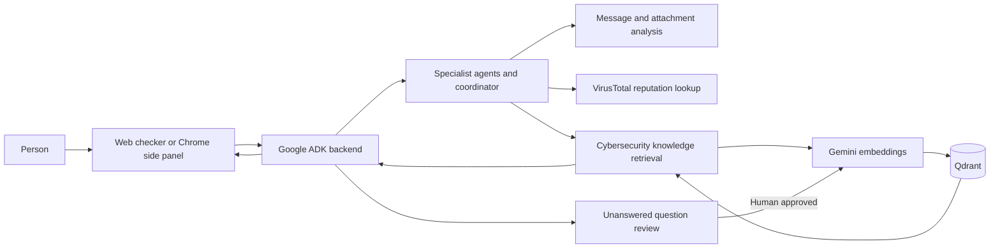

# Project Alesia

### A cybersecurity companion for the moments something feels off.

**Built by Team Kuih-Lapis**

Scams often arrive as an ordinary text, a convincing link, a screenshot, or a download that cannot wait. Project Alesia gives people a place to pause: share what looks suspicious, get a clear risk assessment with supporting evidence, and see a practical next step.

Alesia brings together a browser extension, a web checker, and a multi-agent AI backend. Specialist agents analyze user-provided messages and attachments, check requested URLs against VirusTotal reputation data, and retrieve cybersecurity guidance from a human-reviewed knowledge base. When the knowledge base cannot answer, the question can be reviewed by an engineer and added to the knowledge base after approval.

> AI assessments are guidance, not proof. Verify important claims through an official channel you find independently.

## What Alesia does

- **Checks suspicious messages and screenshots.** Analyze text, images, and supported documents for scam indicators, with evidence-based risk guidance.
- **Checks links and download sources.** Look up URL, domain, or IP reputation through VirusTotal. The browser extension can pause a download while it checks the source domain.
- **Answers cybersecurity questions with retrieved evidence.** The knowledge assistant searches a Qdrant collection and grounds answers in its retrieved records.
- **Improves through human review.** Unanswered questions can be sent to a review sheet. Only approved entries are embedded and added to the knowledge base.
- **Keeps safety guidance close.** The extension includes optional awareness reminders and clear actions when a download reputation check needs attention.

## How it works



## Technology stack

| Area | Technology |
| --- | --- |
| Backend and agent orchestration | Python 3.13, Google ADK |
| Chat and analysis model | Google Gemini 3.5 Flash by default; Ollama and OpenRouter are also supported |
| Embeddings | Google Gemini `gemini-embedding-001`, 768 dimensions by default |
| Vector database | Qdrant, local or Qdrant Cloud |
| Web checker | Next.js, React, TypeScript |
| Browser extension | WXT, React, TypeScript |
| Threat intelligence | VirusTotal MCP read-only lookups |
| Human review | Google Sheets API |
| Optional publishing | Confluence REST API |
| Attachment processing | PDF text extraction and local Tesseract OCR |

## Get started

### Requirements

- Python 3.13
- A Google API key for Gemini chat and embeddings
- A Qdrant instance: local Docker or Qdrant Cloud
- Ollama with `qwen2.5:7b` or an OpenRouter API key if using either alternative chat provider
- Node.js and npm to run the web checker or browser extension
- A VirusTotal AI token (`VTAI_TOKEN`) for reputation checks

### 1. Install the backend

From the repository root:

```powershell
python -m venv .venv
.\.venv\Scripts\python -m pip install --upgrade pip
.\.venv\Scripts\pip install -r requirements.txt
Copy-Item .env.example .env
```

Open `.env` and set the required values. At minimum, configure:

```dotenv
GOOGLE_API_KEY=your_google_api_key
LLM_PROVIDER=google
LLM_MODEL=gemini-3.5-flash
EMBEDDING_PROVIDER=google
EMBEDDING_MODEL=gemini-embedding-001
EMBEDDING_DIM=768
QDRANT_URL=http://localhost:6333
QDRANT_API_KEY=
QDRANT_COLLECTION=multi_agentic_rag_gemini
VTAI_TOKEN=your_virustotal_ai_token
```

The supported `LLM_PROVIDER` values are `google`, `ollama`, and `openrouter`. Google Gemini 3.5 Flash is the default chat model. For Ollama, configure `OLLAMA_MODEL` and `OLLAMA_BASE_URL`; for OpenRouter, provide `OPENROUTER_API_KEY` and `OPENROUTER_MODEL`. Gemini is also the embedding provider by default; Ollama embeddings are available if you intentionally set `EMBEDDING_PROVIDER=ollama`.

Keep `.env` private. Do not commit API keys, service-account files, or other credentials.

### 2. Start Qdrant

For a local instance with persistent Docker storage:

```powershell
docker volume create alesia-qdrant
docker run -d --name alesia-qdrant -p 6333:6333 -v alesia-qdrant:/qdrant/storage qdrant/qdrant
```

To use Qdrant Cloud instead, set `QDRANT_URL` and `QDRANT_API_KEY` in `.env`. Use the **same embedding model and dimension** for ingestion and retrieval against a collection.

### 3. Ingest knowledge

The repository includes a Markdown knowledge file and a question-and-answer CSV. Ingest either or both into the configured collection:

```powershell
.\.venv\Scripts\python -m agents.eval.ingest agents/tools/knowledge/data.md agents/tools/knowledge/navigator-batch-generate-66e2f34668701698ce0e0df3-data.csv
```

CSV question-and-answer rows are stored individually. The importer uses stable point IDs, saves successful batches as it goes, and skips rows already present when the same source is run again.

### 4. Start the backend

```powershell
.\.venv\Scripts\adk.exe api_server agents --port 8000 --host 127.0.0.1 --allow_origins 'regex:chrome-extension://(gjicmadlhaabnjngkinahbedaghaiblf|mhpjopnhfojchhjimknnpoafcgmgjpak)'
```

The API listens at `http://127.0.0.1:8000`. The origin allowlist is for the listed extension IDs; update it if your unpacked extension uses a different ID. The Docker image starts the backend on the `PORT` supplied by Render; configure its environment variables in the Render service settings.

### 5. Run an interface

**Chrome extension**

```powershell
cd extension
npm install
npm run dev
```

The extension opens Chrome with the development build. Its backend URL defaults to `http://127.0.0.1:8000`.

**Web checker**

```powershell
cd web
npm install
```

Create `web/.env.local` with:

```dotenv
NEXT_PUBLIC_API_URL=http://127.0.0.1:8000
```

Then run:

```powershell
npm run dev
```

Without `NEXT_PUBLIC_API_URL`, the web checker runs in demo mode with sample replies.

## Review and evaluation

### Sync approved review-sheet entries

Configure `REVIEW_SHEET_ID` and `GOOGLE_SERVICE_ACCOUNT_FILE`, and share the sheet with the service account. The sheet needs `timestamp_utc`, `question`, `status`, and either `answer` or `model_answer` columns. Only rows marked `approved_review` are upserted.

Preview the sync first:

```powershell
.\.venv\Scripts\python.exe -m agents.tools.functions.ingest.unanswered_sync --dry-run
```

Apply it by omitting `--dry-run`:

```powershell
.\.venv\Scripts\python.exe -m agents.tools.functions.ingest.unanswered_sync
```

### Evaluate retrieval

Run the lightweight keyword-recall baseline:

```powershell
.\.venv\Scripts\python -m agents.eval.ragas --keyword-only
```

Run full RAGAS metrics on a 10-question sample:

```powershell
.\.venv\Scripts\python -m agents.eval.ragas --limit 10
```

The full evaluation uses the configured embedding provider for retrieval and RAGAS embedding metrics. Its generated answers and LLM judging use the configured local `OLLAMA_MODEL`. Gemini calls consume API quota. Reports are written under `.artifacts/`.

## Configuration reference

| Variable | Purpose |
| --- | --- |
| `GOOGLE_API_KEY` | Gemini embeddings and Google services used by the backend |
| `LLM_PROVIDER` | `google` by default; `ollama` and `openrouter` are also supported |
| `LLM_MODEL` | Google chat model; defaults to `gemini-3.5-flash` |
| `OLLAMA_MODEL`, `OLLAMA_BASE_URL` | Optional local chat model and Ollama endpoint; also used by full RAGAS evaluation |
| `OPENROUTER_API_KEY`, `OPENROUTER_MODEL` | OpenRouter chat model settings |
| `EMBEDDING_PROVIDER` | `google` by default; `ollama` is an optional alternative |
| `EMBEDDING_MODEL` | `gemini-embedding-001` by default |
| `EMBEDDING_DIM` | Vector size; defaults to `768` |
| `GOOGLE_EMBEDDING_REQUEST_DELAY_SECONDS` | Delay between Gemini embedding requests; defaults to `2.0` |
| `QDRANT_URL`, `QDRANT_API_KEY`, `QDRANT_COLLECTION` | Qdrant connection and target collection |
| `VTAI_TOKEN` | VirusTotal reputation tools |
| `REVIEW_SHEET_ID`, `GOOGLE_SERVICE_ACCOUNT_FILE` | Optional Google Sheets review queue |
| `CONFLUENCE_*` | Optional Confluence publishing integration |

## Safety and data notes

- Message and attachment assessments use the content the person submits. PDF extraction is limited to the first 20 pages, and uploads are limited to 20 MB.
- Download protection checks the source domain, not the downloaded file contents. Pausing a download is best-effort.
- VirusTotal lookups are read-only. Direct URL reputation checks may disclose the submitted URL to VirusTotal; download checks send the source hostname only.
- A green reputation result or a low AI risk score is not a guarantee that something is safe. Confirm important requests through a trusted, independently found channel.

## Project layout

```text
agents/       ADK backend, specialist agents, retrieval, ingestion, evaluation
extension/    WXT and React Chrome side panel
web/          Next.js web checker
training/     Offline model experiments and reports
```
